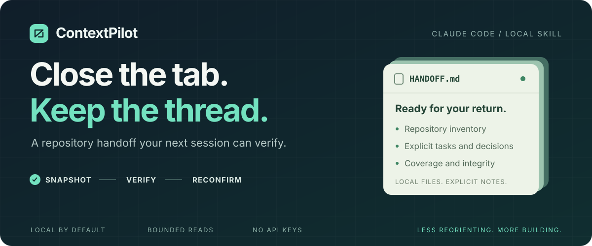
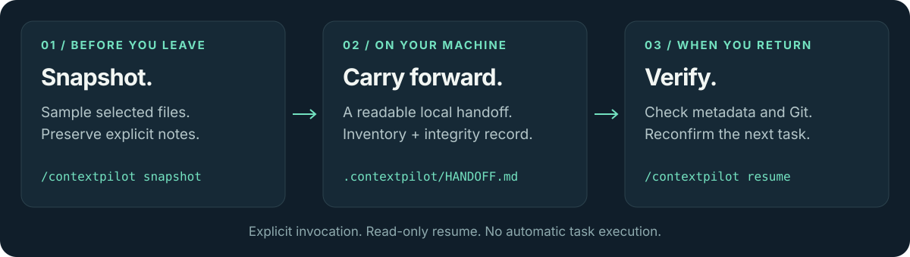
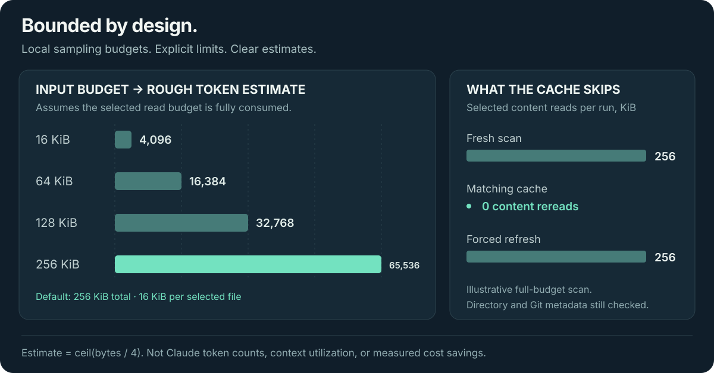

<p align="center">
  <a href="#quick-start"></a>
  <a href="#quick-start"></a>
  <a href="#privacy-and-trust"></a>
  <a href="LICENSE"></a>
</p>

<p align="center">
  <strong>A small local skill for the moment between “done for today” and “where was I?”</strong>
</p>

<p align="center">
  <a href="#quick-start">Install</a> ·
  <a href="#how-it-works">Workflow</a> ·
  <a href="#automatic-context-optimization">Automatic mode</a> ·
  <a href="#pilotboard">Dashboard</a> ·
  <a href="#estimates-at-a-glance">Estimates</a> ·
  <a href="examples/HANDOFF.md">Example handoff</a> ·
  <a href="#reference">Reference</a>
</p>

ContextPilot saves a bounded repository inventory and your explicit notes. When
you return, it checks the handoff against current file metadata and Git state so
you can spot stale information before continuing. **No account, API key, or
runtime Python dependencies.**

## Quick start

For **automatic optimization from session startup**, install the Claude Code
plugin once (Claude Code 2.1.303+, Python 3.11+ and Git):

```sh
claude plugin install contextpilot --marketplace reyu110/ContextPilot
```

Restart Claude Code. The plugin starts eligible optimizations automatically in
each project; there is no per-project `auto on` step. On its first startup it
registers missing native defaults locally; one additional restart loads those
defaults reliably. Existing preferences, selected models and status lines win.
Plugin commands are namespaced: **`/contextpilot:pilotboard`** and
**`/contextpilot:contextpilot status`**. Claude owns this namespacing.

For the standalone `/contextpilot` and `/pilotboard` commands instead:

```sh
npx skills add reyu110/ContextPilot --skill contextpilot --skill pilotboard --agent claude-code --global --yes
```

Then use these commands in Claude Code:

| Before you leave | When you return | Just checking |
| :--- | :--- | :--- |
| `/contextpilot snapshot` | `/contextpilot resume` | `/contextpilot status` |
| Save a local handoff. | Flag changes and review the next task. | Inspect the saved snapshot. |

**Requires Python 3.11+ and Git on PATH.** Node.js/npm is only for installation.
Omit `--global` for a project-only install. Reopen Claude Code if the skill is not
listed. This public repository does not require GitHub authentication.

> Standalone snapshot writes inside `.contextpilot/` and appends its ignore rule.
> Plugin startup also merges owned native defaults into local Claude settings;
> checkpoints run before compaction and at session end. Resume and status stay
> read-only. ContextPilot never executes project tasks or scripts itself.

Open the localhost dashboard with **`/pilotboard`**. Installing both skills gives
you the short alias; `/contextpilot board` works with the main skill alone.

## How it works



| What you keep | What gets checked | What stays yours |
| :--- | :--- | :--- |
| A readable handoff, repository inventory, and explicit tasks and decisions. | File metadata, Git state, handoff integrity, and coverage limits. | Your files and notes stay on your machine during skill execution. |

Use it alongside Claude Code's `/compact`. Compact manages the active
conversation; ContextPilot leaves a reviewable handoff in your working tree.
It cannot recover private chat history or infer your intentions. When its owned
status line is invoked, it can retain Claude's documented numeric context and
allowance readings; missing readings are never guessed.

## Automatic context optimization

The **plugin activates automatically**. Standalone skill users can still opt in
once per project in Claude Code **2.1.303 or newer**:

```text
/contextpilot auto on
```

Restart Claude Code to load the hooks and environment reliably. After that, the
optimizer runs automatically as the conversation continues:

| Behavior | How it reduces context | How to get more detail |
| :--- | :--- | :--- |
| Adapt large file reads | Eligible unbounded text reads over 32 KiB (4 KiB at elevated native context) use line density and context pressure; contiguous follow-up reads can expand, with a partial-view notice | Ask for another offset or explicit limit; explicit requests win |
| Reduce duplicate reads | Identical text Read results within the same prompt return a short reference to the earlier result | Read a different explicit range for a fresh copy |
| Reduce search and listing context | Bound unbounded Grep requests; reference exact repeated eligible file/directory content or counts; shorten absolute Glob/Grep paths without removing matches | Use a different explicit offset/head limit; explicit `head_limit: 0` remains unlimited |
| Compact terminal output | Known test/build/lint commands lose recognized progress and color noise; repeated exact diagnostics and Python/JS/Java stacks keep a complete copy, count and positional references | Unknown commands, machine output and unsupported shapes pass through; commands are never rerun |
| Detect retry loops | Adds a bounded warning at the third identical tool input in a prompt | Legitimate retries remain allowed |
| Guide efficient work | Search first, relevant diffs, targeted tests, scope/preflight checks, justified subagents, stable context and fresh-session guidance | Model compliance is guidance, not a guarantee |
| Repository checkpoints | Reuse the bounded snapshot runtime before compaction and at session end, preserving explicit notes | No chat history or invented decisions |
| Native defaults (plugin) | Missing concise-output, medium-effort, numeric status-line and 70% compaction defaults | Existing preferences and managed policies win; the selected model is never changed |
| Native tool discovery and caching | Reuse Claude's automatic MCP tool deferral and prompt caching on supported deployments; record observed ToolSearch calls and show configuration hints | Existing disable flags remain respected; no invented savings for native calls |
| Audit project instructions | Automatically measure eligible root instructions and `.claude/rules` for size and exact repeated paragraphs | Advisory dashboard report; instructions are never rewritten |

```text
/contextpilot auto status
/contextpilot auto off
```

`auto status` is read-only. `auto off` removes exact owned hooks and unchanged
native defaults, and preserves a pause that plugin startup will honor; restart to
clear the previous environment. In the plugin use the namespaced main command. It
preserves other settings, permission rules, hooks and usage history. This mode
does not rewrite past messages, summarize with a separate paid model, bypass
tool permissions, or read Claude transcripts.

Enabling explicitly updates **`.claude/settings.local.json`** and adds its root
ignore rule along with `.contextpilot/`. Hook paths refer to the installed bundle,
not scripts discovered in your repository. No source or prompt bodies are saved;
only ownership metadata, hashes, opaque identifiers and numeric statistics are
retained in optimizer history. Repository snapshots retain their existing bounded
inventory and handoff contract separately.

Duplicate state resets at prompt, session and compaction boundaries. A result
that started before a boundary cannot become a later prompt's cache anchor.
Files that changed, different ranges, excluded paths, symlinks, non-text outputs,
unknown schemas and unsupported tool failures pass through. If earlier output is no longer visible,
an explicit fresh range returns its content again. Hook errors preserve original
tool behavior. The main conversation's Read and eligible Grep text can be
deduplicated. Known test/build/lint invocations can have progress noise reduced. Subagents,
unknown schemas, background tasks, structured output and credential-like results
pass through. No tool permission is granted or bypassed.

Pilotboard shows **signed net optimizer estimates**, including recorded added
guidance, lifetime/session/prompt breakdowns, per-feature contributions, health,
and native context/allowance samples when available. Its 28-capability inventory
distinguishes filters, native defaults, guidance and recommendation-only controls.
Expandable panels show native input/output/cache components, context capacity,
the reported session cost, allowance reset times and observed style/effort, plus
file-level instruction audit coverage and staleness. Native samples are
current-window observations, not cumulative token consumption. Cache-read share
describes cache use; it is never counted as saved tokens or money.
Tool-search and prompt-cache configuration hints distinguish native defaults,
explicit disabled/enabled preferences, custom values and unavailable settings.
They inspect saved settings and the dashboard process's environment, not the
running Claude process or managed policy. A recorded ToolSearch call is an
observation with zero estimated savings. The capability table and its limitations
panel distinguish enforceable filters, native functionality and model guidance.
Earlier ledger rows keep their lifetime value without fabricated timestamps.
These totals are separate from snapshot scenarios. Smaller reads can need more
tool calls, compaction itself can consume tokens, and provider caching changes
cost: **neither token savings nor invoice savings are guaranteed**. See the
[optimizer contract](.claude/skills/contextpilot/references/optimizer.md).

## Pilotboard

**`/pilotboard`** opens a local visual dashboard with lifetime totals, session
breakdowns, a 7/30-day timeline, and paginated snapshot-prompt details. Choose a
session, compare sampled context with the generated handoff, and adjust the
input-token dollar rate to explore an approximate value.

Plugin-only installs use `/contextpilot:pilotboard`. The live optimizer section
updates every 15 seconds while visible and immediately on returning to the tab.
Opening the board never activates hooks, creates a snapshot, or writes history.
Automatic operation does not require keeping the board open.

| View | What it covers |
| :--- | :--- |
| Lifetime | Every recorded snapshot request in this project, since tracking began |
| Session | Requests grouped by an explicitly supplied Claude session ID |
| By prompt | One row per snapshot request, including baseline, handoff, signed net estimate and dollar scenario |

New snapshots automatically record numeric counts, time and identifiers in
`.contextpilot/usage.sqlite3`. There is no backfill, transcript access, prompt
body storage or ordinary-chat tracking. Requests without a session ID appear as
unassigned. Use `--session-id` and optionally `--prompt-id` with the snapshot CLI
to group requests explicitly; repeating a prompt ID in the same session retains
its first estimate instead of counting it twice.

**The savings are a scenario, not a measurement of your Claude bill:**

```text
baseline = retained sampled-file bytes + explicit notes JSON bytes (when present)
net estimated tokens = ceil(baseline / 4) − ceil(generated handoff bytes / 4)
approximate USD = net estimated tokens × selected USD-per-million rate / 1,000,000
```

This assumes the sampled context would otherwise be read once. Small projects
can produce larger handoffs; those negative values stay visible. The editable
default of $3 per million input tokens is illustrative, not a current model price.
Responses, system/tool overhead, actual billing and provider cache discounts are
excluded. Cached disk reads avoided are displayed separately.

The server binds only to `127.0.0.1` on an available port, opens your default
browser, and requires a random access key for its read-only API. No external
fonts, scripts or services load. Keep the complete printed URL private. Stop the
background job or press Ctrl+C in its terminal to stop the server. Opening the
dashboard never scans or writes project artifacts. The browser remembers a rate
only for the current localhost origin; a new port may reset it.

Run without Claude Code:

```sh
python3 .claude/skills/contextpilot/scripts/pilotboard.py --root /path/to/project
```

Use `--no-browser` for a terminal-only launch, `--port N` to choose a port, and
`--session-id ID` to open a specific session. Prompt pages contain 50 requests;
session lists show the most recent 100 groups. Lifetime totals always include
the whole project's ledger, including older sessions.

## Estimates at a glance

A larger scan budget means more local sampling. The numbers below make that
tradeoff visible; **they are arithmetic illustrations, not performance claims.**



The default reads up to **120 selected files**, **256 KiB total**, and **16 KiB
per file**. Each generated scan JSON or handoff is capped at **64 KiB**. Truncation
is reported. A matching cache skips content rereads, while directory and Git
metadata checks still run.

## Privacy and trust

The skill runs locally, filters ignored and sensitive paths before sampling, and
skips symlinks. It does not run repository scripts, export source file bodies, or
make external network requests. The `npx` installer downloads the skill;
Pilotboard serves numeric estimates over authenticated loopback HTTP. The
installed Python runtime does not upload your repository.

**Review before sharing.** Filenames, dependency signals and human notes can
contain private information. Secret detection is heuristic. A metadata match
cannot prove unread content is unchanged or that old tasks are still valid.

## Carry decisions, not guesses

The scanner cannot know what you discussed. Add only supplied or explicitly
confirmed information to `.contextpilot/notes.json` during an explicit snapshot
invocation. Notes survive regeneration; human claims still need reconfirmation.
See the [note contract](.claude/skills/contextpilot/references/handoff-template.md)
and the [generated example](examples/HANDOFF.md).

## Reference

The short path is above. The implementation details are here when you need them.

<details>
<summary><strong>Notes schema and validation</strong></summary>

The scanner cannot know conversations or intentions. Before an explicit snapshot,
put only supplied or confirmed information in `.contextpilot/notes.json`:

```json
{
  "objectives": [{"text": "Finish the import command", "source": "user"}],
  "decisions": [{"text": "Keep storage as local JSON", "source": "confirmed"}],
  "completed": [{"text": "Parser implementation reviewed", "source": "user"}],
  "tasks": [{"text": "Add malformed input coverage", "source": "user"}],
  "blockers": [],
  "next_steps": []
}
```

All sections are optional. Sources are `user`, `confirmed`, and `assumption`;
decisions require `confirmed`, meaning explicit human confirmation. The tool
validates this label but cannot authenticate who confirmed a note. Empty sections
remain explicitly unknown. Maximum: 32 KiB notes file, 50 notes per section,
1000 characters per note. Notes are preserved across snapshots. Edit notes rather
than the generated handoff to carry changes into the next snapshot. See the
[handoff contract](.claude/skills/contextpilot/references/handoff-template.md).

</details>

<details>
<summary><strong>Scan limits, estimate arithmetic, and cache behavior</strong></summary>

| Boundary | Default size | Rough token equivalent |
| :--- | ---: | ---: |
| Sample from one selected file | Up to 16 KiB | 4,096 |
| Total selected file content per scan | Up to 256 KiB | 65,536 |
| Each generated scan JSON or handoff | Up to 64 KiB | 16,384 |

Input samples are inspected locally; source file bodies are not exported. Output
is metadata, coverage, labels and explicit notes. The input and output estimates
describe different data and cannot establish a compression ratio or token savings.
The snapshot CLI's output estimate combines scan JSON and handoff bytes.

| Flag | Default | Meaning |
| --- | ---: | --- |
| `--max-files` | 120 | Maximum selected file read attempts; also caps Git change entries |
| `--max-bytes` | 262144 | Total selected file-content bytes read per scan |
| `--max-file-bytes` | 16384 | Maximum bytes read from each selected file |
| `--max-candidates` | 20000 | Eligible discovered file entries examined before stopping traversal |
| `--max-output-bytes` | 65536 | UTF-8 bytes per scan JSON or handoff/continuation output; minimum 4096 |

These limits apply to scanner content and generated output, not operating system
directory listings or Git subprocess metadata. Notes and previous handoffs have
separate fixed read limits. Git commands have a 15-second timeout. Very large
worktrees may still incur directory/Git inspection cost. Truncation is reported;
lower-ranked detail is dropped while handoff section headings remain present.

Every scan checks file names, sizes, nanosecond mtimes, limits and Git metadata.
If their fingerprint matches the previous snapshot, content reads are reused.
This avoids rereading unchanged files, not directory traversal. Status avoids
traversal entirely. `snapshot --refresh` forces selected content reads. Resume
does not save its fresh scan. All scans include approximate input bytes/tokens;
snapshot CLI output also reports artifact bytes and approximate output tokens.
The estimate is bytes / 4, not a tokenizer or a claim about model utilization.

</details>

<details>
<summary><strong>Architecture and local artifact layout</strong></summary>

| Mode | Reads | Writes |
| :--- | :--- | :--- |
| `snapshot` | Bounded repository selection + explicit notes | Local artifacts + root ignore rule |
| `resume` | Saved handoff + current bounded scan | Nothing |
| `status` | Saved scan metadata | Nothing |
| Plugin hooks | Eligible tool results, settings metadata, explicit notes | Owned local defaults, numeric/hash receipts, bounded checkpoints |
| Pilotboard | Snapshot/optimizer ledgers and ownership metadata | Nothing |

Pilotboard is served by `scripts/pilotboard.py` with bundled HTML/CSS/JavaScript.
`scripts/usage.py` owns the project-local SQLite ledger and estimate aggregation.
SQLite is part of Python's standard library; there are no new runtime packages.
`optimizer.py` owns hook lifecycle, configuration and numeric native samples;
`policies.py` owns conservative text filters and bounded guidance;
`search_results.py` owns privacy-verified search/list transforms;
`instruction_audit.py` owns bounded instruction metadata audits;
`optimizer_report.py` owns read-only aggregation and migration-compatible views.
The `pilotboard` companion is only an alias; the runtime remains self-contained
inside the main `contextpilot` bundle.

- `scan.py` owns deterministic discovery, privacy filtering, Git inspection,
  prioritization, bounded text reads, cache fingerprints and confined artifact I/O.
- `snapshot.py` owns note validation, labeled Markdown, one-generation backup,
  resume comparison and CLI modes. No repository code is imported or executed.
- The skill bundle is self-contained, so `${CLAUDE_SKILL_DIR}` works after copying
  it globally or into another project. The project requires no Python package import.

Ranking favors README/architecture docs, manifests, filename-based entry points,
changed files, source files and tests, with path depth penalties and lexical
tie-breaking. Framework signals are dependency word matches in selected manifests;
they are not proof a framework is actually used. Architecture output is a structural
inventory, not a model-generated explanation of runtime behavior.

Snapshots include overview, architecture, important files/directories, objectives,
confirmed decisions, completed work, unfinished tasks, Git changes, blockers and
next steps. Observed metadata, user notes, confirmed notes and assumptions have
distinct labels. See the real generated [example](examples/HANDOFF.md).

### What stays on disk

```text
.contextpilot/                  # Ignored by Git
├── HANDOFF.md                  # Human-readable handoff
├── HANDOFF.previous.md         # One previous handoff, after a repeat snapshot
├── scan.json                   # Selected file metadata and scan coverage
├── snapshot.json               # Fingerprint and handoff integrity record
└── notes.json                  # Optional, explicitly supplied notes
```

New snapshots also maintain `.contextpilot/usage.sqlite3` for numeric usage
history. SQLite may create temporary journal files in that same directory.

</details>

<details>
<summary><strong>Manual installation and CLI commands</strong></summary>

### Install

Python 3.11+ must be available as `python3`, and Git must be on PATH, including
when inspecting a project that has never been initialized with Git.

The quick-start command installs across your projects. Omit `--global` to install
only in the current project. This repository is public; GitHub authentication is
not required to download it.

Alternatively, clone or download this repository, then copy the **entire skill
directory** using one of the commands below.

Personal installation, available across your projects:

```sh
mkdir -p ~/.claude/skills
cp -R .claude/skills/contextpilot ~/.claude/skills/
cp -R .claude/skills/pilotboard ~/.claude/skills/
```

Project installation, available only in a selected project:

```sh
mkdir -p /path/to/project/.claude/skills
cp -R .claude/skills/contextpilot /path/to/project/.claude/skills/
cp -R .claude/skills/pilotboard /path/to/project/.claude/skills/
```

Run these from this checkout. If the destination already contains ContextPilot,
back up any edits and replace that directory rather than nesting another copy.
On Windows, copy the same directory with Explorer or PowerShell and use `py -3`
for direct CLI commands. Claude must have permission to run Python and Git.
Reopen Claude Code if the skill is not discovered. No pip install is required
for the skill; installing the Python project alone does not install the skill.

### Use in Claude Code

```text
/contextpilot snapshot
/contextpilot resume
/contextpilot status
/contextpilot snapshot --refresh --max-files 80 --max-bytes 131072
```

Standalone slash commands require explicit invocation (`disable-model-invocation:
true`); installed plugin lifecycle hooks run automatically. `snapshot` creates or refreshes `.contextpilot/scan.json` and
`.contextpilot/HANDOFF.md`, saves an integrity record as `snapshot.json`, and adds
`/.contextpilot/` to the project's `.gitignore`. This ignore-file append is the
sole outside write for a snapshot. Automatic setup additionally merges owned
local Claude defaults and their ignore rule. No application source files are modified.
An existing handoff is backed up as `HANDOFF.previous.md` before replacement;
there is one backup, not an archive. Nothing is automatically staged or committed.

`resume` reads the handoff and checks current file metadata and Git state. It
flags changed, missing or no-longer-selected files, edits to the handoff, and the
next documented unfinished task. It never updates the saved snapshot or executes
tasks. Human notes always need reconfirmation. `status` reports the saved snapshot
without scanning or writing; no arguments defaults to status in Claude Code.

The Python CLI works independently of Claude Code:

```sh
python3 .claude/skills/contextpilot/scripts/snapshot.py snapshot --root /path/to/project
python3 .claude/skills/contextpilot/scripts/snapshot.py resume --root /path/to/project
python3 .claude/skills/contextpilot/scripts/snapshot.py status --root /path/to/project
python3 .claude/skills/contextpilot/scripts/scan.py --root /path/to/project
```

The last command prints JSON to stdout and writes nothing. Errors return exit
code 2 with an explanation on stderr. Redirecting stdout is your responsibility;
the tool provides no arbitrary artifact output-path option.

</details>

<details>
<summary><strong>Privacy rules and trust boundaries</strong></summary>

Git's ignore engine honors nested `.gitignore` rules and negations, even in
non-Git directories via a temporary bare Git directory outside the project. If
Git is unavailable or ignore checking fails, discovery fails closed and surfaces
a warning rather than inspecting potentially ignored files. Tracked files that
match ignore rules are excluded too. The scanner makes no network requests and
does not use subprocess shells, repository scripts, diffs, author identities, commit messages, or exported
file bodies. Recent commit metadata contains only short hashes and dates.

The scanner skips `.env*`, credential/secret/token filenames, SSH/private-key
files, common credential directories, dependencies, virtual environments, build
outputs, `.git`, and `.contextpilot`. It only considers known text extensions and
selected extensionless manifests, rejects sampled NUL/non-UTF-8 data, and skips
files whose sampled text resembles common credentials. Every symlink is skipped,
including internal links; symlinked artifact or `.gitignore` paths are rejected.
New artifact files have private permissions where supported. Existing `.gitignore`
content is preserved and the root ignore rule is appended once.

Repository content and notes remain untrusted data. Neither Python code nor the
skill should obey instructions embedded in a repository or handoff. Review notes
and output before sharing: no secret detector can recognize every custom secret,
and paths, language counts, dependency signals and human notes can themselves
contain private information. Git ignore files/configuration are read by Git.
The tool is not a sandbox for concurrent hostile filesystem mutation.

</details>

<details>
<summary><strong>Known limitations</strong></summary>

- Hook filtering covers recognized native Read, Grep, Glob and terminal output
  schemas. Some Claude versions use Bash searches instead of Grep/Glob; arbitrary
  shell searches are not rewritten. Ambiguous directory output passes through.
- Instruction audits cover up to 32 eligible project files and 256 KiB of text;
  they do not inspect personal instructions, rewrite rules or count actual prompt
  tokens. Runtime guidance cannot enforce model choices or reasoning behavior.
- Native samples require Claude to invoke the owned status line. Existing status
  lines are preserved. Exact billed savings and a longer subscription allowance
  cannot be inferred from text reductions or cache composition.
- Automatic main-session model/effort switching has no verified command-hook
  control. Hooks cannot delete past chat turns; native compaction owns that
  behavior. Runtime instruction rewriting is outside the permitted artifact writes.
  Search order, test selection and task reasoning remain guidance: ContextPilot
  cannot enforce them without risking the user's requirements.
- Only selected UTF-8 text files are sampled. Unread portions, unknown extensions,
  excluded paths and files beyond discovery/selection limits are not understood.
- Entry points are filename candidates; framework detection is a text heuristic.
  The MVP does not parse call graphs or summarize implementation semantics.
- Metadata cache checks cannot detect content changes with restored size and
  mtime, or changes beyond a truncated inventory. Use `--refresh` when uncertain.
- Git renames show the destination path. Git change listings are capped. No Git
  executable means a warning and empty discovery, including for non-Git projects.
- A snapshot is individually atomic per artifact, not a multi-file transaction;
  interruption can leave mixed generations. Resume flags handoff integrity issues;
  rerun snapshot after reviewing notes if interrupted.
- Windows paths and process APIs are supported where practical; the current test
  run is on macOS, and Windows installations may restrict symlink creation.

</details>

<details>
<summary><strong>Development and tests</strong></summary>

```sh
python3 -m venv .venv
.venv/bin/python -m pip install -e '.[test]'
.venv/bin/python -m pytest
```

On Windows use `.venv\Scripts\python.exe`. Tests use temporary repositories and
require Git and loopback socket access for the dashboard HTTP tests. They cover discovery/ranking, Git status and renames, non-Git/empty
projects, ignore rules, secrets/binaries, symlinks, Unicode, missing files, large
inventories, snapshot notes/backups, resume/cache, limits and skill frontmatter.
Dashboard tests also cover signed estimates, session grouping, pagination,
concurrent ledger writes, API access controls and read-only behavior. No API key
or external network is required once pytest is installed.

</details>

<details>
<summary><strong>Troubleshooting</strong></summary>

- **Skill not listed:** copy the directory, not just SKILL.md; confirm the path is
  `~/.claude/skills/contextpilot/SKILL.md` or the project's equivalent and reopen
  Claude Code. Use an explicit invocation; automatic model invocation is disabled.
- **Git unavailable / empty results:** install Git, check PATH, and read warnings.
  Non-Git projects still need Git for faithful ignore matching. Empty snapshots
  may also result from privacy/ignore rules or unsupported text extensions.
- **Missing handoff:** explicitly run `snapshot` first. Status/resume create nothing.
- **Stale handoff:** review tasks and decisions with the user, update notes, then
  snapshot again. Use `--refresh` for fresh content reads.
- **Malformed notes / artifact:** fix the JSON using the documented schema. If a
  saved scan is damaged, `snapshot --refresh` bypasses the cached scan. Never
  delete notes without backing them up.
- **Symlink refused / permission denied:** use a real project directory and real
  artifact paths with local write permission. Do not point `.contextpilot` at
  another directory. `.gitignore` must also be a normal file.
- **Output truncated:** increase limits deliberately. Broadening discovery also
  broadens private metadata exposure. Check Coverage and size and scanner warnings.

</details>

---

## License

Distributed under the [Prosperity Public License 3.0.0](LICENSE): free for
noncommercial use, with a thirty-day trial for commercial use. See the full
license for its terms and exceptions. The license text comes from the
[official v3.0.0 release](https://github.com/licensezero/prosperity-public-license/blob/v3.0.0/LICENSE.md).

Earlier revisions published under MIT retain their MIT permissions; this change
does not revoke previously granted licenses. Each installable skill includes its
own copy of the current license and contributor/source notices.

Built with Python's standard library.
[Contributions](CONTRIBUTING.md) are welcome; keep changes small, local, and honest
about what the scanner can verify.
