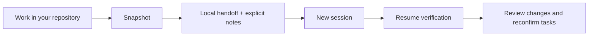
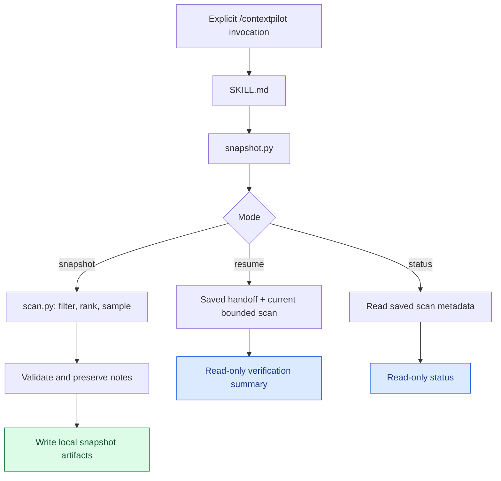
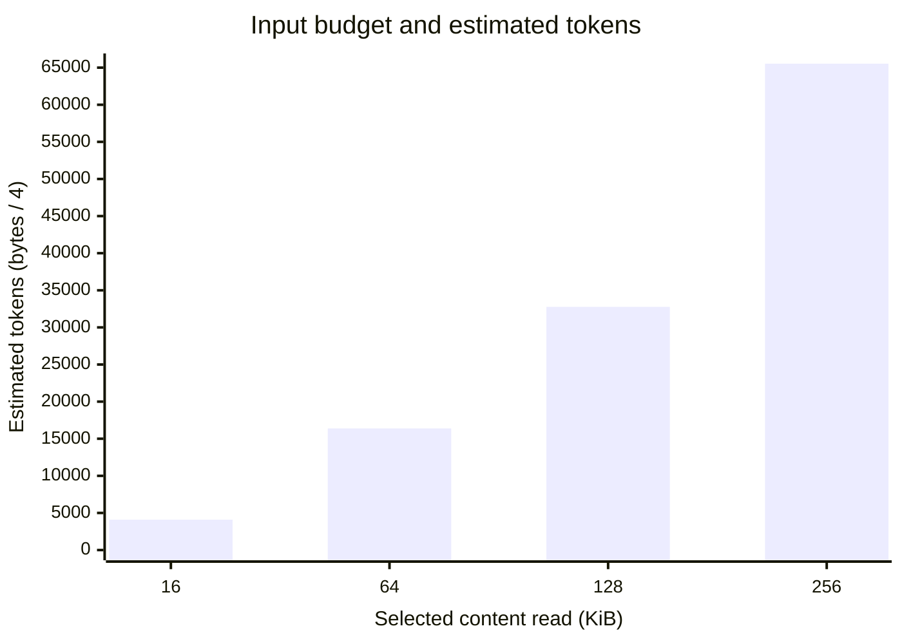
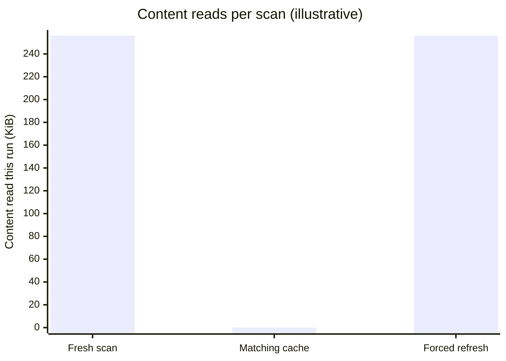

# ContextPilot

**Leave a useful handoff. Resume with a reality check.**

[](#install)
[](#quick-start)
[](#architecture)
[](LICENSE)

ContextPilot is a local **Claude Code skill** that saves a bounded repository
snapshot and checks it when you return. Carry explicit tasks and decisions into
your next session without a database, API key, or cloud service.

| Save | Verify | Stay in control |
| :--- | :--- | :--- |
| Repository inventory + explicit notes | Flag stale files, Git state and handoff edits | Local artifacts, bounded reads, explicit invocation |



It complements Claude Code's `/compact`: compact manages the active conversation;
ContextPilot stores explicit project observations and notes in your working tree
so a later session can check and resume them. It cannot recover private session
history or measure Claude's exact context-window usage.

[Quick start](#quick-start) · [Estimates](#estimates-at-a-glance) ·
[Architecture](#architecture) · [Privacy](#privacy-and-trust) ·
[Example handoff](examples/HANDOFF.md)

## Quick start

Install once, then invoke explicitly in Claude Code:

```sh
npx skills add reyu110/ContextPilot --skill contextpilot --agent claude-code --global --yes
```

```text
/contextpilot snapshot
/contextpilot resume
/contextpilot status
```

Reopen Claude Code if the skill is not discovered. Requires **Python 3.11+ and
Git** on PATH; Node.js/npm is needed only for the installer.

> Snapshot writes inside `.contextpilot/` and appends `/.contextpilot/` to
> `.gitignore`. Resume and status are read-only. Tasks never execute automatically.

## Install

Python 3.11+ must be available as `python3`, and Git must be on PATH, including
when inspecting a project that has never been initialized with Git.

The quick-start command installs across your projects. Omit `--global` to install
only in the current project. This repository is public; GitHub authentication is
not required to download it.

Alternatively, clone or download this repository, then copy the **entire skill
directory** using one of the commands below.

Personal installation, available across your projects:

```sh
mkdir -p ~/.claude/skills
cp -R .claude/skills/contextpilot ~/.claude/skills/
```

Project installation, available only in a selected project:

```sh
mkdir -p /path/to/project/.claude/skills
cp -R .claude/skills/contextpilot /path/to/project/.claude/skills/
```

Run these from this checkout. If the destination already contains ContextPilot,
back up any edits and replace that directory rather than nesting another copy.
On Windows, copy the same directory with Explorer or PowerShell and use `py -3`
for direct CLI commands. Claude must have permission to run Python and Git.
Reopen Claude Code if the skill is not discovered. No pip install is required
for the skill; installing the Python project alone does not install the skill.

## Use in Claude Code

```text
/contextpilot snapshot
/contextpilot resume
/contextpilot status
/contextpilot snapshot --refresh --max-files 80 --max-bytes 131072
```

Only explicit user invocation enables the skill (`disable-model-invocation:
true`). `snapshot` creates or refreshes `.contextpilot/scan.json` and
`.contextpilot/HANDOFF.md`, saves an integrity record as `snapshot.json`, and adds
`/.contextpilot/` to the project's `.gitignore`. This ignore-file append is the
sole write outside `.contextpilot/`. No application source files are modified.
An existing handoff is backed up as `HANDOFF.previous.md` before replacement;
there is one backup, not an archive. Nothing is automatically staged or committed.

`resume` reads the handoff and checks current file metadata and Git state. It
flags changed, missing or no-longer-selected files, edits to the handoff, and the
next documented unfinished task. It never updates the saved snapshot or executes
tasks. Human notes always need reconfirmation. `status` reports the saved snapshot
without scanning or writing; no arguments defaults to status in Claude Code.

The Python CLI works independently of Claude Code:

```sh
python3 .claude/skills/contextpilot/scripts/snapshot.py snapshot --root /path/to/project
python3 .claude/skills/contextpilot/scripts/snapshot.py resume --root /path/to/project
python3 .claude/skills/contextpilot/scripts/snapshot.py status --root /path/to/project
python3 .claude/skills/contextpilot/scripts/scan.py --root /path/to/project
```

The last command prints JSON to stdout and writes nothing. Errors return exit
code 2 with an explanation on stderr. Redirecting stdout is your responsibility;
the tool provides no arbitrary artifact output-path option.

## Preserve decisions and tasks

The scanner cannot know conversations or intentions. Before an explicit snapshot,
put only supplied or confirmed information in `.contextpilot/notes.json`:

```json
{
  "objectives": [{"text": "Finish the import command", "source": "user"}],
  "decisions": [{"text": "Keep storage as local JSON", "source": "confirmed"}],
  "completed": [{"text": "Parser implementation reviewed", "source": "user"}],
  "tasks": [{"text": "Add malformed input coverage", "source": "user"}],
  "blockers": [],
  "next_steps": []
}
```

All sections are optional. Sources are `user`, `confirmed`, and `assumption`;
decisions require `confirmed`, meaning explicit human confirmation. The tool
validates this label but cannot authenticate who confirmed a note. Empty sections
remain explicitly unknown. Maximum: 32 KiB notes file, 50 notes per section,
1000 characters per note. Notes are preserved across snapshots. Edit notes rather
than the generated handoff to carry changes into the next snapshot. See the
[handoff contract](.claude/skills/contextpilot/references/handoff-template.md).

## Architecture



- `scan.py` owns deterministic discovery, privacy filtering, Git inspection,
  prioritization, bounded text reads, cache fingerprints and confined artifact I/O.
- `snapshot.py` owns note validation, labeled Markdown, one-generation backup,
  resume comparison and CLI modes. No repository code is imported or executed.
- The skill bundle is self-contained, so `${CLAUDE_SKILL_DIR}` works after copying
  it globally or into another project. The project requires no Python package import.

Ranking favors README/architecture docs, manifests, filename-based entry points,
changed files, source files and tests, with path depth penalties and lexical
tie-breaking. Framework signals are dependency word matches in selected manifests;
they are not proof a framework is actually used. Architecture output is a structural
inventory, not a model-generated explanation of runtime behavior.

Snapshots include overview, architecture, important files/directories, objectives,
confirmed decisions, completed work, unfinished tasks, Git changes, blockers and
next steps. Observed metadata, user notes, confirmed notes and assumptions have
distinct labels. See the real generated [example](examples/HANDOFF.md).

### What stays on disk

```text
.contextpilot/                  # Ignored by Git
├── HANDOFF.md                  # Human-readable handoff
├── HANDOFF.previous.md         # One previous handoff, after a repeat snapshot
├── scan.json                   # Selected file metadata and scan coverage
├── snapshot.json               # Fingerprint and handoff integrity record
└── notes.json                  # Optional, explicitly supplied notes
```

## Estimates at a glance

The scanner uses **`ceil(bytes / 4)`** as a rough token estimate. The chart below
shows arithmetic at four hypothetical input read budgets, assuming each budget
is fully consumed. Only 256 KiB is the default; these are **not benchmarks** or
measurements of Claude's context window.



| Boundary | Default size | Rough token equivalent |
| :--- | ---: | ---: |
| Sample from one selected file | Up to 16 KiB | 4,096 |
| Total selected file content per scan | Up to 256 KiB | 65,536 |
| Each generated scan JSON or handoff | Up to 64 KiB | 16,384 |

Input samples are inspected locally; source file bodies are not exported. Output
is metadata, coverage, labels and explicit notes. The input and output estimates
describe different data and cannot establish a compression ratio or token savings.
The snapshot CLI's output estimate combines scan JSON and handoff bytes.

### What the cache avoids

For an illustrative scan that consumes the full default input budget, a matching
cache avoids rereading selected file content. A forced refresh reads it again:



**Zero content rereads does not mean zero work.** Cache checks still inspect
directory entries and Git metadata. Saved artifacts are read too. `status` skips
repository traversal entirely. Actual runtime and model cost have not been
benchmarked; smaller scans may read far less than these limits.

## Bounds and cache

| Flag | Default | Meaning |
| --- | ---: | --- |
| `--max-files` | 120 | Maximum selected file read attempts; also caps Git change entries |
| `--max-bytes` | 262144 | Total selected file-content bytes read per scan |
| `--max-file-bytes` | 16384 | Maximum bytes read from each selected file |
| `--max-candidates` | 20000 | Eligible discovered file entries examined before stopping traversal |
| `--max-output-bytes` | 65536 | UTF-8 bytes per scan JSON or handoff/continuation output; minimum 4096 |

These limits apply to scanner content and generated output, not operating system
directory listings or Git subprocess metadata. Notes and previous handoffs have
separate fixed read limits. Git commands have a 15-second timeout. Very large
worktrees may still incur directory/Git inspection cost. Truncation is reported;
lower-ranked detail is dropped while handoff section headings remain present.

Every scan checks file names, sizes, nanosecond mtimes, limits and Git metadata.
If their fingerprint matches the previous snapshot, content reads are reused.
This avoids rereading unchanged files, not directory traversal. Status avoids
traversal entirely. `snapshot --refresh` forces selected content reads. Resume
does not save its fresh scan. All scans include approximate input bytes/tokens;
snapshot CLI output also reports artifact bytes and approximate output tokens.
The estimate is bytes / 4, not a tokenizer or a claim about model utilization.

## Privacy and trust

Git's ignore engine honors nested `.gitignore` rules and negations, even in
non-Git directories via a temporary bare Git directory outside the project. If
Git is unavailable or ignore checking fails, discovery fails closed and surfaces
a warning rather than inspecting potentially ignored files. Tracked files that
match ignore rules are excluded too. There are no network operations, subprocess
shells, repository scripts, diffs, author identities, commit messages, or exported
file bodies. Recent commit metadata contains only short hashes and dates.

The scanner skips `.env*`, credential/secret/token filenames, SSH/private-key
files, common credential directories, dependencies, virtual environments, build
outputs, `.git`, and `.contextpilot`. It only considers known text extensions and
selected extensionless manifests, rejects sampled NUL/non-UTF-8 data, and skips
files whose sampled text resembles common credentials. Every symlink is skipped,
including internal links; symlinked artifact or `.gitignore` paths are rejected.
New artifact files have private permissions where supported. Existing `.gitignore`
content is preserved and the root ignore rule is appended once.

Repository content and notes remain untrusted data. Neither Python code nor the
skill should obey instructions embedded in a repository or handoff. Review notes
and output before sharing: no secret detector can recognize every custom secret,
and paths, language counts, dependency signals and human notes can themselves
contain private information. Git ignore files/configuration are read by Git.
The tool is not a sandbox for concurrent hostile filesystem mutation.

## Limitations

- Only selected UTF-8 text files are sampled. Unread portions, unknown extensions,
  excluded paths and files beyond discovery/selection limits are not understood.
- Entry points are filename candidates; framework detection is a text heuristic.
  The MVP does not parse call graphs or summarize implementation semantics.
- Metadata cache checks cannot detect content changes with restored size and
  mtime, or changes beyond a truncated inventory. Use `--refresh` when uncertain.
- Git renames show the destination path. Git change listings are capped. No Git
  executable means a warning and empty discovery, including for non-Git projects.
- A snapshot is individually atomic per artifact, not a multi-file transaction;
  interruption can leave mixed generations. Resume flags handoff integrity issues;
  rerun snapshot after reviewing notes if interrupted.
- Windows paths and process APIs are supported where practical; the current test
  run is on macOS, and Windows installations may restrict symlink creation.

## Develop and test

```sh
python3 -m venv .venv
.venv/bin/python -m pip install -e '.[test]'
.venv/bin/python -m pytest
```

On Windows use `.venv\Scripts\python.exe`. Tests use temporary repositories and
require Git. They cover discovery/ranking, Git status and renames, non-Git/empty
projects, ignore rules, secrets/binaries, symlinks, Unicode, missing files, large
inventories, snapshot notes/backups, resume/cache, limits and skill frontmatter.
No API key or network is required to run tests once pytest is installed.

## Troubleshooting

- **Skill not listed:** copy the directory, not just SKILL.md; confirm the path is
  `~/.claude/skills/contextpilot/SKILL.md` or the project's equivalent and reopen
  Claude Code. Use an explicit invocation; automatic model invocation is disabled.
- **Git unavailable / empty results:** install Git, check PATH, and read warnings.
  Non-Git projects still need Git for faithful ignore matching. Empty snapshots
  may also result from privacy/ignore rules or unsupported text extensions.
- **Missing handoff:** explicitly run `snapshot` first. Status/resume create nothing.
- **Stale handoff:** review tasks and decisions with the user, update notes, then
  snapshot again. Use `--refresh` for fresh content reads.
- **Malformed notes / artifact:** fix the JSON using the documented schema. If a
  saved scan is damaged, `snapshot --refresh` bypasses the cached scan. Never
  delete notes without backing them up.
- **Symlink refused / permission denied:** use a real project directory and real
  artifact paths with local write permission. Do not point `.contextpilot` at
  another directory. `.gitignore` must also be a normal file.
- **Output truncated:** increase limits deliberately. Broadening discovery also
  broadens private metadata exposure. Check Coverage and size and scanner warnings.

## Possible version 0.2 work

User-configurable exclusion rules with privacy floors, manifest-aware declared
entry points, richer deterministic architecture signals, incremental per-file
content caching, crash-consistent snapshot generations, and Windows/Linux CI.
These are recommendations, not implemented features.
